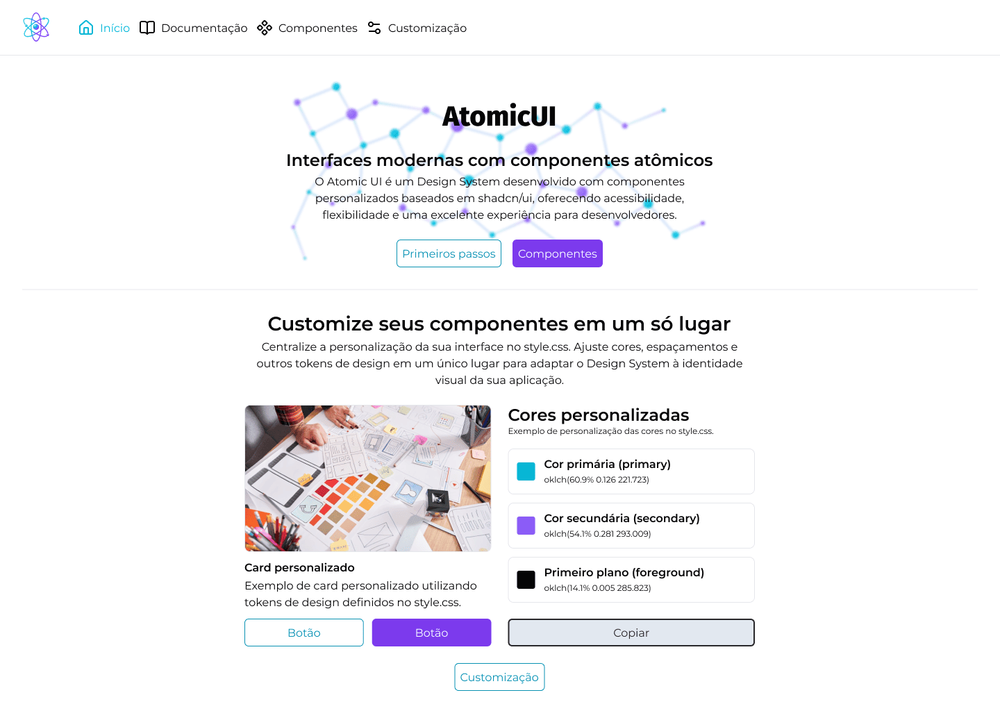
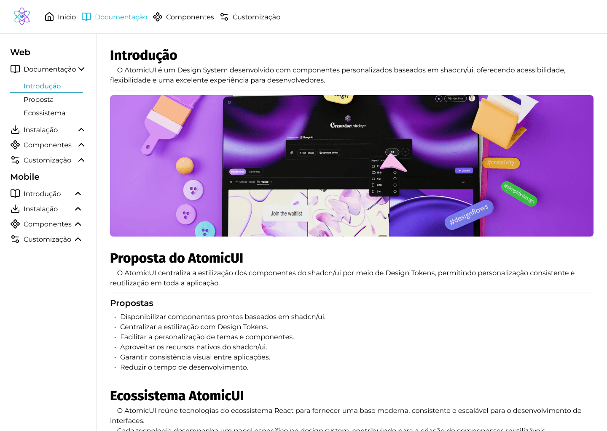
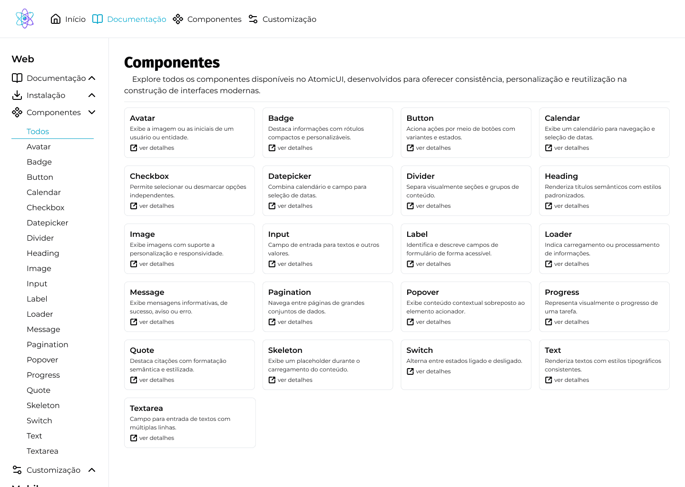
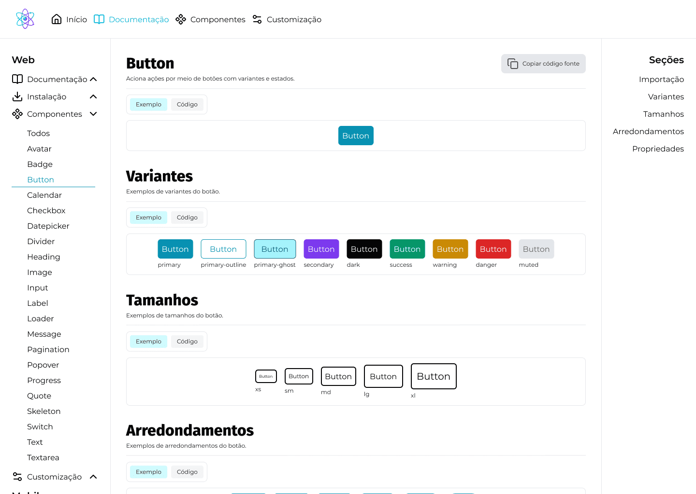

# Atomic UI

Atomic UI is a React design system with reusable, customizable components and a browser-based showcase for their documentation and examples.

[Live demo](https://atomic-ui.vercel.app) · [GitHub repository](https://github.com/cemgthedev/Atomic-UI) · [Documentation](https://atomic-ui.vercel.app/documentation)

## Showcase

Explore the dashboard, browse the component catalog, and inspect live examples and source code.









## Problem and goals

Building each interface from scratch makes visual consistency and reuse harder. Atomic UI brings common interface patterns together in one design system, with centralized styling and practical examples.

It is intended for React developers who want a consistent starting point for modern web interfaces. The goal is to make components easier to discover, customize, and reuse.

## Key features

- **Reusable component catalog:** 37 UI components covering actions, content, navigation, and form controls.
- **Live component documentation:** Browse examples, variants, and source code in the app.
- **Centralized design tokens:** Adjust shared colors and spacing to customize the visual identity.
- **Composable APIs:** Combine smaller components to build more complex interface patterns.
- **Interactive foundations:** Uses Radix UI primitives for common interaction patterns.
- **Component stories:** Storybook provides a focused environment for component examples and browser tests.

## Tech stack

| Category | Technologies |
| --- | --- |
| UI | React 19, TypeScript |
| Build and routing | Vite, React Router |
| Styling | Tailwind CSS 4, CSS design tokens |
| UI primitives and variants | Radix UI, Class Variance Authority |
| Component utilities | `clsx`, `tailwind-merge`, `lucide-react` |
| Documentation and testing | Storybook, Vitest, Playwright |

## Architecture overview

The Vite application is under `app/`. Its router loads the dashboard, documentation, installation guide, and component detail pages. Shared UI components are exported from one barrel file; component-specific stories support the showcase and testing workflow.

```text
app/
└── src/
    ├── components/
    │   ├── structures/   # Shared page layout
    │   └── ui/            # Reusable components
    ├── pages/             # Dashboard, docs, installation, component pages
    ├── stories/           # Component stories
    ├── style/             # Global styles and design tokens
    ├── constants/         # Navigation and URL definitions
    └── utils/             # Shared helpers
docs/
└── screenshots/           # README showcase images
```

```text
Browser → React Router → Page and shared layout → UI components
                                      └──────────→ Stories and examples
```

## Technical trade-offs

- **Radix UI primitives with project-owned styling:** Radix supplies interaction foundations for applicable components, while Atomic UI retains control of its visual system. This keeps styling flexible but means the project must maintain its own component styles and APIs.
- **Centralized tokens:** Shared tokens make broad visual changes easier and promote consistency; component styles need to follow those tokens to stay aligned.
- **Documentation in the application:** Live examples keep usage close to the components, but documentation quality depends on keeping the pages and stories up to date as the APIs evolve.
- **Application-first delivery:** The repository provides a Vite app and showcase rather than a configured package publishing workflow.

## Results and lessons

Atomic UI brings a 37-component React catalog, installation and usage documentation, token customization examples, and component stories into one project. Its structure separates reusable UI from page composition and makes the components easy to explore in context.

The project highlights the value of defining shared tokens early and pairing reusable components with examples. Those choices support consistency and discoverability, while also making clear that component APIs, documentation, and stories need to evolve together.

## Run locally

```bash
cd app
npm install
npm run dev
```

To explore component stories locally:

```bash
npm run storybook
```
